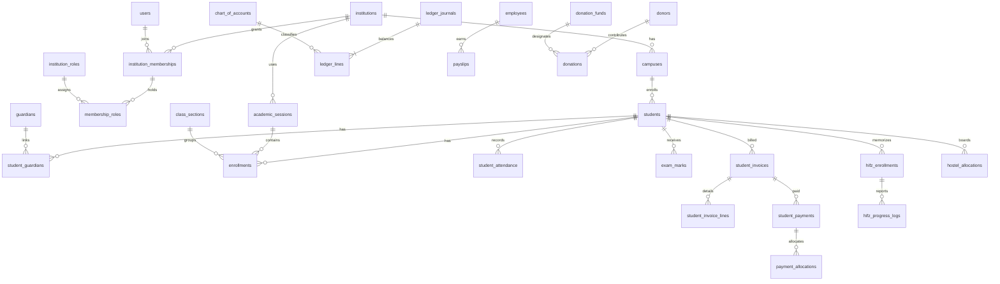

# Core ER Diagram — Laravel/MySQL

The diagram highlights major relationships; the complete schema has 105 additional domain tables. Each tenant-owned relationship uses institution_id as part of its foreign key.

**Important:** Foreign keys alone are not sufficient to enforce approvals, accounting balance, result publication, fee calculation, historical retention, or authorization. Those need Laravel application services and automated tests.
