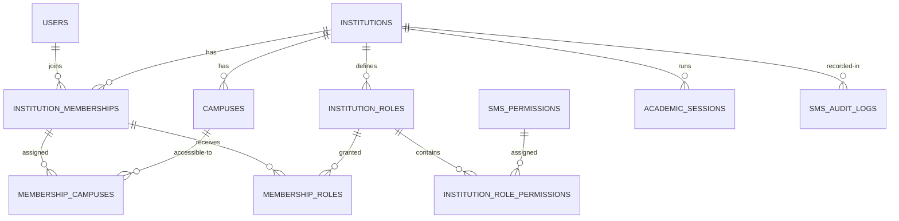

# Database Design — Phase 1 & Planned Domain Map

## A. Implemented migration (14 tables)

This Laravel migration *defines*, but has not yet created, the following tables in a database:

| Table | Key columns | Cardinality / constraint |
|---|---|---|
| `institutions` | id PK; code unique; slug unique; name, type, status, timezone, locale, currency | Independent tenant |
| `campuses` | id PK; institution_id FK; code | Institution 1:N campuses; unique (institution_id, code) |
| `institution_memberships` | id PK; institution_id FK; user_id FK; status; can_access_all_campuses | User N:M institutions; unique (institution_id, user_id) |
| `membership_campuses` | institution_id; membership_id; campus_id | Membership N:M campuses; paired composite FKs enforce same institution |
| `institution_roles` | id PK; institution_id FK; key | Institution 1:N roles; unique (institution_id, key) |
| `sms_permissions` | id PK; key unique; module, label | Global permission catalog only; not global grants |
| `institution_role_permissions` | role_id; permission_id | Role N:M permissions |
| `membership_roles` | institution_id; membership_id; role_id | Membership N:M roles; composite FKs prevent cross-institution assignment |
| `platform_admin_users` | user_id PK/FK; granted_by_user_id | Separate high-trust platform operator registry |
| `institution_module_settings` | institution_id; module_key; enabled; options JSON | Unique institution/module; feature toggle does not bypass RBAC |
| `academic_sessions` | institution_id; code; name; starts_on; ends_on; status | Unique institution/session code |
| `sms_audit_logs` | institution_id?; actor_user_id?; action; resource; JSON details; created_at | Tenant-aware audit stream (application-enforced append-only) |
| `sms_idempotency_records` | institution_id; operation; idempotency_key; request_sha256; status | Unique per institution+operation+key |
| `sms_outbox_events` | institution_id; event_type; aggregate; payload; status; attempts | Reliable event delivery pattern (worker not yet provided) |

**Dependency:** Standard Laravel `users` table already present. The migration intentionally does not redefine it. `users` may be shared by the same person across institutions but must not carry a single global institution role.

## B. ERD — Security & Tenant Core

## C. Planned domain tables (not in Phase 1 migration)

These represent the target logical data model. They need separate design reviews and migrations in their implementation phases; names, keys and cardinalities can evolve based on signed-off rules.

| Domain | Planned core tables |
|---|---|
| Academic | academic_departments, academic_programs, academic_classes, class_sections, subjects, subject_offerings, class_routines, academic_calendars |
| SIS | students, guardians, student_guardians, student_documents, student_enrollments, student_status_history, student_siblings |
| Admission | admission_cycles, admission_forms, admission_applications, admission_documents, applicant_tests, merit_lists, admission_decisions |
| Attendance | attendance_sessions, student_attendance, staff_attendance, attendance_corrections, leave_requests, biometric_events |
| Exams | exam_types, exams, exam_components, exam_schedules, grade_scales, subject_marks, result_approvals, report_cards |
| Finance | chart_of_accounts, fiscal_periods, journal_entries, journal_lines, fee_plans, invoices, invoice_lines, payment_transactions, receipts, allocations, waivers, refunds, bank_reconciliations |
| HR | staff, contracts, staff_assignments, salary_structures, payroll_runs, payslips, leave_balances |
| Messaging | message_templates, messages, notification_recipients, delivery_attempts, parent_meetings |
| Library | library_titles, library_copies, library_loans, library_reservations, library_fines |
| Hostel & Transport | hostels, rooms, beds, bed_allocations, meal_plans, vehicles, transport_routes, route_stops, student_transport_assignments |
| Inventory & Assets | inventory_items, inventory_locations, stock_movements, requisitions, purchase_orders, goods_receipts, fixed_assets |
| Hifz | hifz_programs, hifz_enrollments, hifz_lessons, hifz_revision_logs, hifz_assessments |
| Scholarship & Donations | scholarships, scholarship_awards, donors, donations, restricted_funds, fund_disbursements |
| Welfare | student_incidents, health_records, emergency_contacts, counseling_sessions, case_access_grants |
| Certificates | certificate_templates, certificates, certificate_revocations, certificate_verification_events |
| Visitor & Events | visitors, visitor_passes, campus_events, room_reservations, facility_assets |
| Integrations | provider_connections, external_identifiers, integration_events, payment_webhooks, device_sync_runs |

### Mandatory future FK patterns

- Student enrollment: `(institution_id, student_id)` and `(institution_id, academic_session_id)` must reference same-tenant composite unique keys.
- Financial invoice: `(institution_id, student_id)` and each payment allocation must be institution-consistent; prevent cross-tenant invoicing.
- Fee receipts: unique `(institution_id, receipt_number)`; provider transaction ID unique per provider/merchant context.
- Marks: uniqueness per student/exam/subject/component/version; use immutable publication snapshots where needed.
- Guardian authorization: `student_guardians` records checked on *every* parent-scoped query.
- Files: storage references protected by owner institution, owner record, classification and policy; never expose raw storage path publicly.

### Database integrity rules

1. Use unique indexes for business keys in addition to application validation.
2. Use composite foreign keys where accidental cross-tenant references would otherwise be possible.
3. Financial postings occur in ACID transactions; avoid multi-step writes without transaction boundaries.
4. Add indexes based on query patterns, including institution_id + academic_session_id/class_id/status.
5. Apply row-level authorization at the app layer; MySQL does not provide PostgreSQL-style native RLS policies.
6. Pin chosen database/version in deployment documentation and verify charset, collation, strict SQL mode and FK support.
