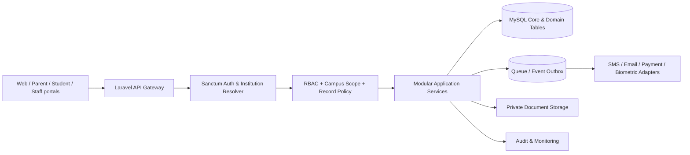

# SMS/ERP — Phase 1 Architecture & Foundation

**Project:** School, College & Madrasha Management System  
**Revision:** 1.0 • 2026-11-04  
**Implementation status:** Initial Laravel foundation files prepared; application integration and database execution are pending.

## 1. Decisions and assumptions

| Topic | Phase-1 decision | Reason |
|---|---|---|
| Product model | One codebase for school, college, madrasha and mixed institutions | Shared core + institution-configured modules |
| Deployment model | Multi-institution, optional multi-campus | Allows standalone installation or SaaS |
| Tenant model | Shared MySQL database; tenant column `institution_id` | Practical launch cost and simple migrations |
| Tenant authorization | Route-scoped institution + *active membership* + permission checks | A supplied institution ID is not authorization |
| Campus authorization | Explicit all-campus flag or per-campus assignments | Supports branch-restricted users |
| Backend | Laravel + PHP 8.2+ | Existing project ecosystem and maintainability |
| Database | MySQL 8+ (production) | Transactional integrity and FK support |
| API | REST JSON under `/api/v1/` | Web and future mobile clients |
| Frontend | Vue + Tailwind (proposed, not implemented) | Consistent responsive UI |
| Authentication | Laravel Sanctum | Web sessions and API tokens as appropriate |
| Background jobs | Redis + Laravel queues (planned) | Reliable SMS, email, report processing |
| Localization | Bangla/English from start | Institution and user preferences |
| Time and money | Store timestamps in UTC, institution timezone for display; money in integer minor units | Avoid timezone drift and floating-point rounding |
| Sensitive records | Private file storage; strict read permissions | Minimize exposure of children/guardian data |

**Important:** `institution_id` must be enforced in *every* institution-owned model, query, export, import, background job, webhook and report. Public/global master data must be explicitly classified. Database foreign keys alone do not replace authorization checks.

## 2. Logical system architecture

Keep module boundaries separate even if implemented in a modular monolith. Each domain owns its tables, commands, policies, validation and tests. Cross-module effects use transactions and queued outbox events as required.

## 3. Modules, bounded contexts and dependencies

| Module | Owns | Depends on |
|---|---|---|
| Platform & Institutions | institutions, campuses, subscription/feature configuration | Auth |
| Security & Identity | users, memberships, roles, permissions, audit records | Institutions |
| Academic Foundation | sessions, programs, classes, sections, subjects, academic calendars | Institutions, Campus |
| SIS & Student Lifecycle | students, guardians, enrollment history, transfers, graduation | Academic Foundation |
| Admissions | applications, merit lists, approvals | SIS, Finance |
| Attendance | sessions, roll call, leave, device events | SIS, Academics |
| Examinations | assessments, marks, grading rules, results | SIS, Academics |
| Finance | invoices, receipts, ledger, waivers, reconciliation | SIS, Institutions |
| HR & Payroll | staff, salary structure, attendance, payroll | Finance, Institution |
| Communications | messages, notifications, delivery logs | All transactional domains |
| Library | catalog, copies, loans | SIS/HR |
| Hostel & Transport | occupancy, routes, fee mapping | SIS, Finance |
| Inventory & Assets | items, stock movements, procurement, asset register | Finance |
| Madrasha/Hifz | sabaq, sabqi, manzil, assessments | SIS, Academics |
| Scholarships & Donations | award programs, donors, restricted funds | SIS, Finance |
| Welfare | medical, incident, discipline, safeguarding | SIS, Security |
| Certificates | templates, issuance, verification/revocation | SIS, Examinations |
| Campus & Events | visitors, gates, events, facilities | Campus, Security |
| Integrations | payment, SMS, biometric, email, webhooks | Security, Outbox |
| Reporting & Analytics | authorized reporting projections | All bounded contexts |

## 4. Institution context lifecycle (implemented in starter)

1. Authenticate the caller with Sanctum.
2. Resolve institution slug from the route (`/v1/institutions/{institution}/...`).
3. Confirm institution is active and caller has an **active membership** in *that institution*.
4. Store institution ID, membership ID, actor user ID, and campus scope in a **request-scoped** context object.
5. Check permission key before reaching controller.
6. Scope every data query by the resolved institution. For campus-sensitive resources, also enforce allowed campuses. Where needed, enforce assigned-student/class/guardian relationships through record-level policies.
7. Emit audit logs on state-changing or sensitive operations. Never return private data without a policy decision.

**Platform administrators are not automatically institution members.** Central administration is a separate, more restricted application surface, with explicit audited impersonation/grants if later required.

## 5. API conventions

- Root: `/api/v1/institutions/{slug}/...`; the `/api` segment comes from Laravel API routing.
- Authentication: Sanctum, not unauthenticated institution selection.
- Resource IDs: opaque/ULID public IDs are recommended for new student/financial entities; internal numeric DB IDs can be retained internally.
- Format: `{ "data": ... }` on success; standard validation errors (422), unauthorized (401), forbidden (403), not found (404), conflict (409).
- Paginate all large directories and filters. Never permit unbounded sensitive-data exports.
- POST/PATCH commands that may repeat (financial transactions) require idempotency keys and conflict detection.
- Version APIs and reject unknown/unsafe filters or fields.

**Starter endpoints included**: `GET /api/v1/institutions/{slug}/context` (`dashboard.view`) and `GET /api/v1/institutions/{slug}/campuses` (`campuses.view`, campus scoped). They are proof-of-foundation endpoints, not a finished ERP.

## 6. Financial domain requirements (to implement in later phases)

- Double-entry journal: `journal_entries` and `journal_lines`, each posting balanced per institution, currency, journal and accounting period.
- Do not delete posted financial entries; correct via auditable reversal and reposting.
- Fees: invoices and line items, scheduled charge definitions, waivers, discounts, partial payments, refunds, reconciliation ledger.
- Gateway callbacks: verify signatures, use provider-specific transaction uniqueness and idempotent processing; never trust a browser success redirect as proof of settlement.
- Amounts: integer minor units or precise DECIMAL at DB layer, never binary float in money operations.
- Period closing: prohibit backdated changes once closed except controlled adjustment period.
- Daily reconciliation: subledger receivables = GL control account; cash/bank clearing = verified provider payouts.
- Restricted donations: separate fund codes and spending authorization per eligible purpose.

## 7. Domain rules to protect from first release

- `students` has permanent institution-scoped student identity; `enrollments` is a separate history table (`student_id`, `academic_session_id`, `class_id`, `section_id`, `campus_id`, status/dates).
- Promotion appends new enrollment; never edits earlier years' class results.
- Guardian link is a separate, verified relationship; parent portal is not authorized by matching a mobile number alone.
- Marks are a draft/approved/published workflow. Every post-publication amendment requires an approval and audit entry.
- Hifz progress tracks lesson/revision observations, instructor and dates (Sabaq/Sabqi/Manzil), distinct from academic grade reporting.
- Private medical/safeguarding files must be segregated from regular document search and ordinary teacher access.
- External notification delivery is asynchronous, retried with bounds and logged; notifications must not duplicate financial posting.

## 8. Retention, audit and recovery

- Every privileged write and authorization change must emit immutable append-only audit records with actor, institution, action, target, timestamp and correlation ID. Do not log credentials, OTPs, payment credentials or full medical details.
- Backups must be encrypted, off-server, routinely monitored and restore-tested. Define RPO/RTO by institution and contractual tier before launch.
- Database migration deployments require tested rollback **plan**; destructive `migrate:rollback` should not be run on a live database without backup/review.
- Implement MFA for high-risk roles, session timeout, rate-limiting, CSRF protection for browser sessions, secure cookies and fine-grained file access.
- Tenant isolation testing is mandatory for reads, writes, exports, webhooks and background jobs.

## 9. Phase 1 done versus still required

| Deliverable | Status |
|---|---|
| Architecture and tenant model | **Specified** |
| Core schema migration for institutions/RBAC/sessions/ops | **Source files prepared, not executed** |
| Tenant resolution middleware | **Source file prepared, not integrated** |
| Permission middleware and catalog | **Source file prepared, not integrated** |
| Two example API endpoints | **Source files prepared, not integrated** |
| Server-console first-institution bootstrap | **Command source prepared, not executed** |
| Automated test cases | **Authored, not executed** |
| Login UI, full roles UI, staff invites | **Not implemented** |
| Core domain migrations for student, exams, finance etc. | **Phase-specific design; not implemented** |
| Production backup, monitoring, security scan | **Not configured** |

## 10. Phase 1 completion criteria

- Clean Laravel installation can migrate schema and seed permission catalog successfully on target MySQL version.
- All three included tenant-access tests run successfully; additional integration tests cover IDs, foreign keys, suspended users, campus assignment and role revocation.
- Cross-tenant writes fail at application and composite-FK levels.
- Platform and institution administrator capabilities are separate and auditable.
- First institution, first campus, first administrator and academic session can be provisioned via controlled commands.
- Documentation captures reproducible install/deploy, backup restore test, security controls and secret management.

**No production-readiness claim is made until these criteria have been verified in a real environment.**
